# Pasang Sistem Iklan Meta + AI
## 4 langkah. Setelah itu Claude yang bekerja.

> Ikuti urutannya. Tiap langkah ada gambar dan ditutup tanda **Selesai kalau**. Panduan ini bukan jaminan hasil iklan dan bukan produk resmi Meta atau Anthropic. Tampilan menu bisa berubah; bila berbeda dari gambar, cari nama menu yang paling mirip.

---

## Sebelum mulai

<div class="peta"><div>1<br><small>Akun Meta</small></div><div>2<br><small>Buka Claude Code</small></div><div>3<br><small>Hubungkan</small></div><div>4<br><small>Mulai</small></div></div>

Siapkan: **akun Facebook**, **nama usaha dan logo**, **metode pembayaran**, **alamat tujuan klik** (situs atau formulir), **gambar atau video iklan**, dan **langganan Claude berbayar** (syarat memakai Claude Code).

Sistem ini membuat iklan dalam keadaan **jeda**. Tidak ada uang keluar sampai Anda sendiri menulis persetujuan menyalakan.

> **Catatan:** Meta membuka fitur ini **bertahap per akun iklan**. Bila akun iklan Anda belum dibuka, Claude akan memberi tahu di awal (lihat "Bila macet").

---

## Langkah 1 · Siapkan akun Meta (satu atap)

Halaman, Instagram, dan akun iklan harus berada di **satu Portofolio Bisnis**. Ini kesalahan nomor satu pemula. Sudah punya semuanya? Cukup periksa.

1. Buka **business.facebook.com**, masuk dengan akun Facebook Anda.
2. Buat **Portofolio Bisnis** (nama usaha, nama Anda, email kerja).
3. Menu **Akun**: tambahkan **Halaman**, **Akun Instagram**, dan **Akun iklan**.
4. Di akun iklan, pasang **metode pembayaran**. Zona waktu dan mata uang tidak bisa diubah nanti, jadi periksa.

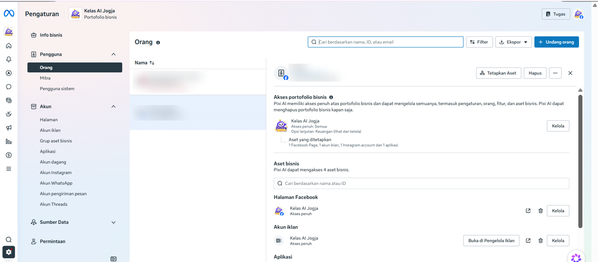

**Selesai kalau:** di **Pengguna → Orang → nama Anda**, bagian **Aset bisnis** menampilkan Halaman Facebook dan Akun iklan di bawah portofolio yang sama.

---

## Langkah 2 · Buka Claude Code

Tidak ada yang perlu dipasang. Buka **aplikasi Claude** di komputer Anda, masuk dengan akun Claude berbayar, lalu klik ikon **`</>`** (tab **Code**) di kiri atas.

**Selesai kalau:** tab **Code** terbuka. Itu tempat Anda bekerja di langkah berikutnya.

---

## Langkah 3 · Hubungkan Claude ke Meta Ads

> **Penting:** masuk Facebook dengan **akun yang sama** dengan pemilik akun iklan Anda. Kalau punya lebih dari satu akun Facebook, pastikan yang benar. Ini sebab nomor satu "akun iklan saya tidak muncul".

### 3.1 · Buka menu Plugin
Di aplikasi Claude, klik **Plugin** di menu sebelah kiri.

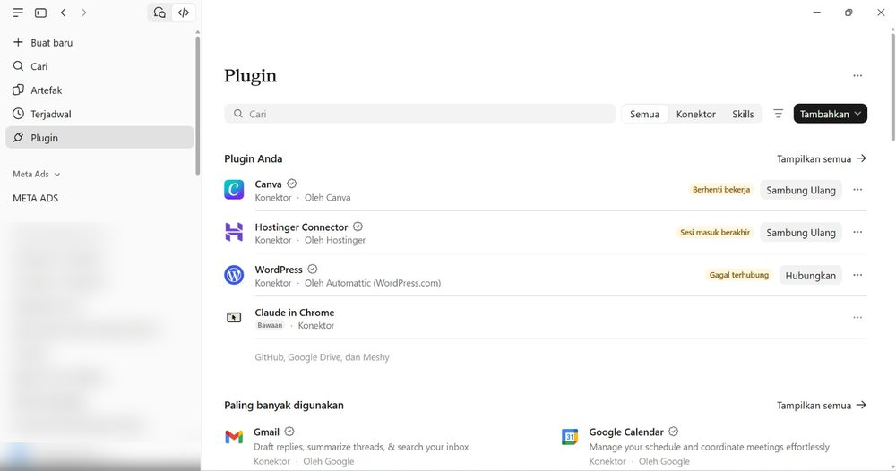

### 3.2 · Tambahkan konektor kustom
Klik **Tambahkan** (kanan atas), lalu pilih **Tambah konektor kustom**.

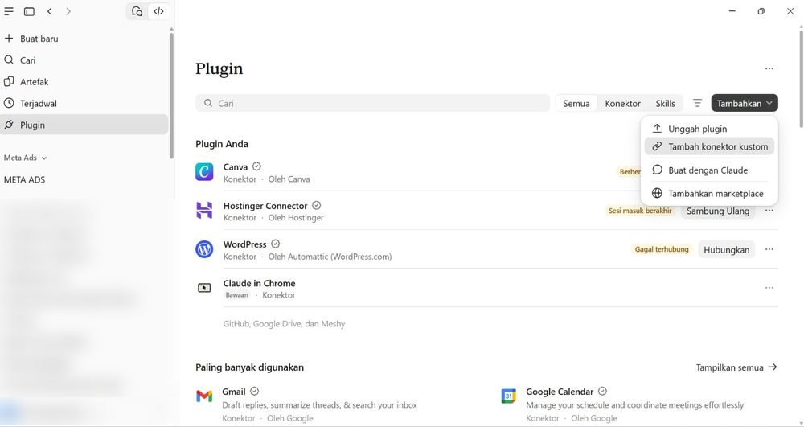

### 3.3 · Isi nama dan alamat server
Isi nama `META ADS` dan alamat berikut. **Harus ada `/ads` di belakangnya.**

`https://mcp.facebook.com/ads`

Lalu klik **Lanjutkan**.

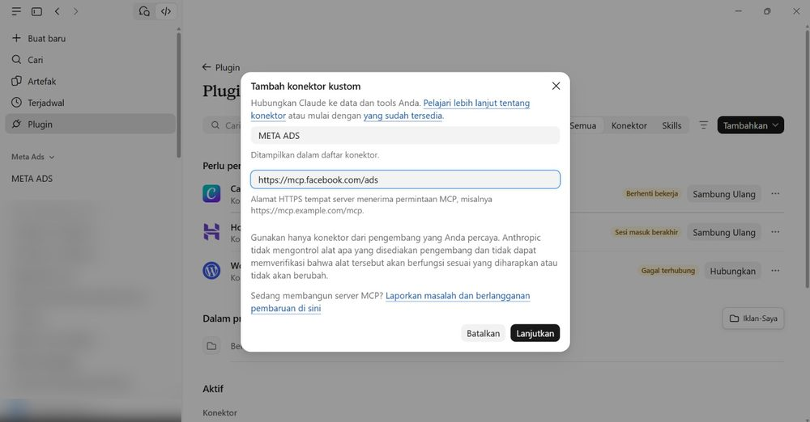

### 3.4 · Peringatan "404" itu normal
Claude memeriksa alamat dan menampilkan peringatan. Abaikan, klik **Lanjutkan saja**.

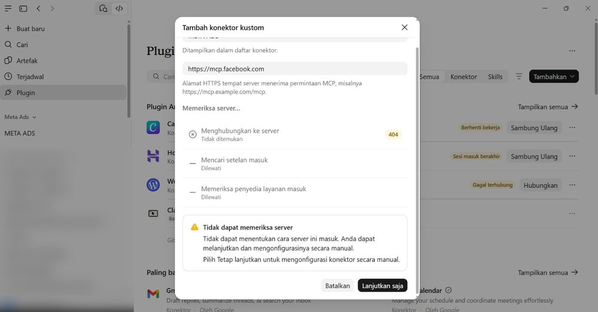

### 3.5 · Biarkan pengaturan bawaan
Jangan ubah apa pun (Autentikasi: **Masuk sekarang**, Klien OAuth: **Gunakan identitas resmi Claude**). Gulir ke bawah dan klik **Lanjutkan** atau **Tambahkan**.

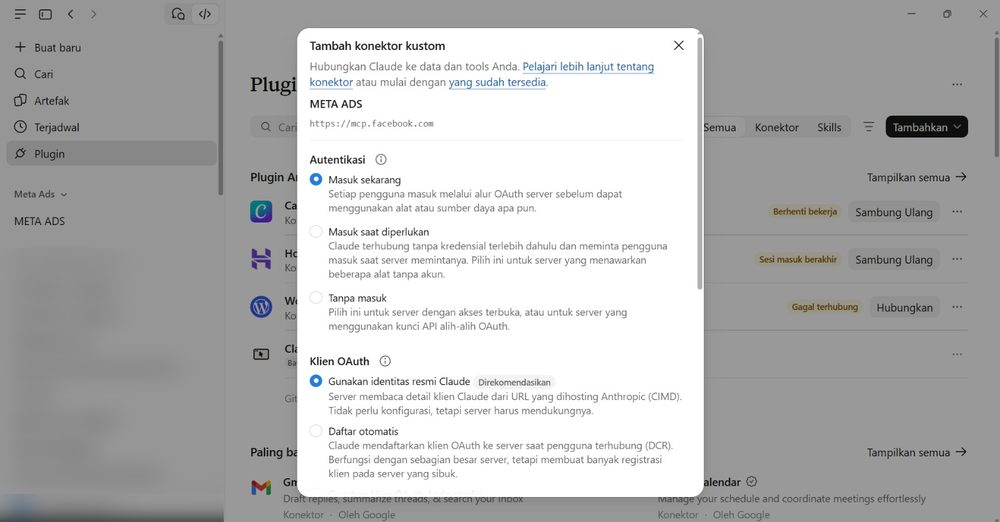

### 3.6 · Klik Hubungkan
Konektor **META ADS** muncul dengan status **Tidak terhubung**. Klik **Hubungkan**.

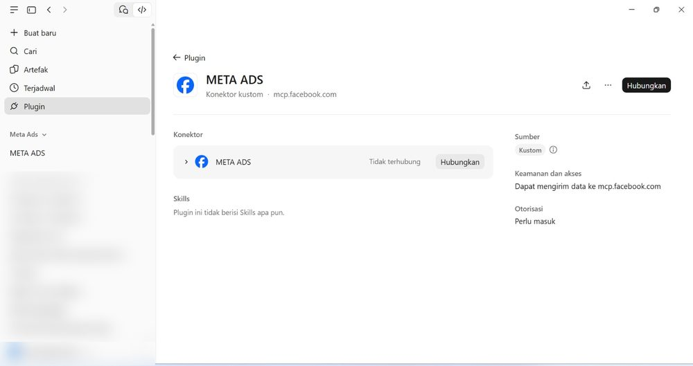

### 3.7 · Masuk ke Facebook
Peramban terbuka. Masuk dengan email dan kata sandi Facebook **Anda sendiri**. Alamatnya harus milik `facebook.com`.

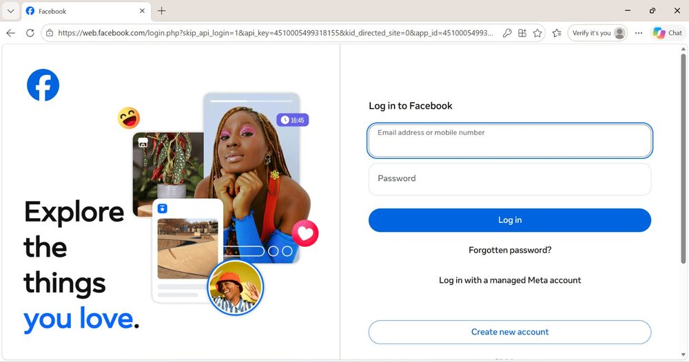

### 3.8 · Kode verifikasi
Bila diminta, masukkan **kode 6 digit** dari aplikasi autentikasi Anda. Centang **Percayai perangkat ini**.

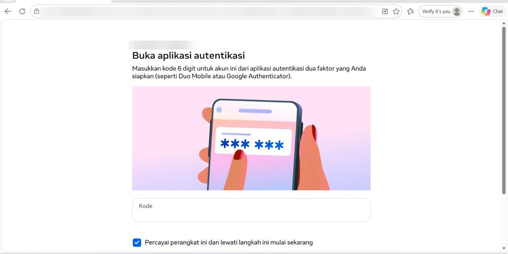

### 3.9 · Izinkan koneksi
Facebook bertanya "Hubungkan Claude ke ads MCP server?". Klik **Lanjutkan**.

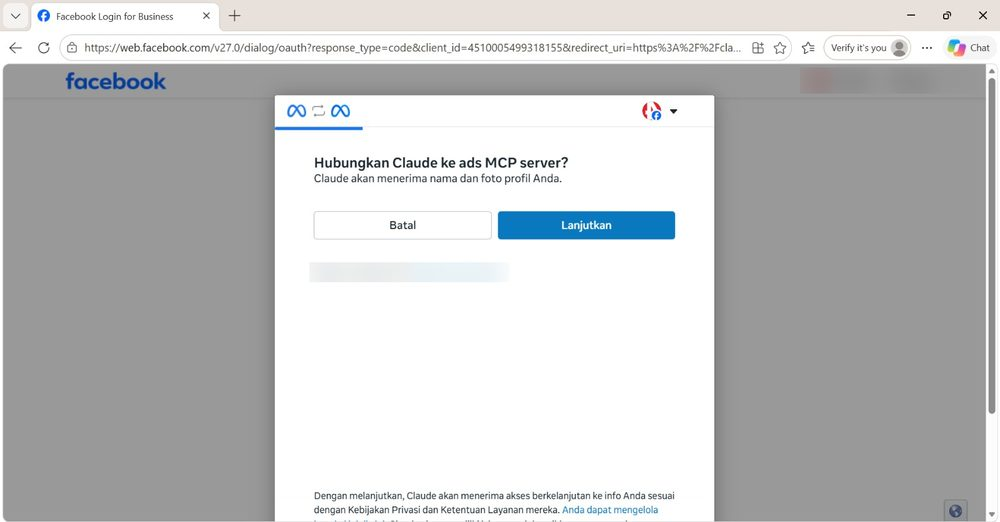

### 3.10 · Pilih aset yang boleh diakses
Ikuti layar berikutnya (Halaman, Bisnis, Akun Instagram, akun iklan). Pilih yang Anda pakai, lalu klik **Lanjutkan** di tiap layar sampai selesai.

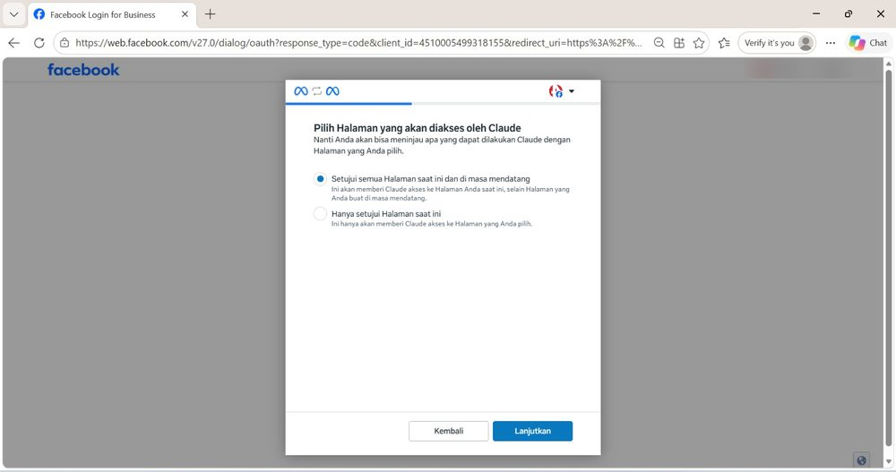

### 3.11 · Simpan
Layar **Tinjau apa yang bisa diakses oleh Claude** menampilkan daftar izin. Klik **Simpan**.

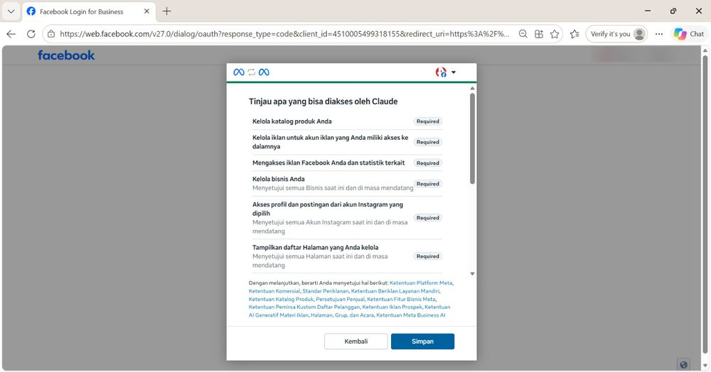

### 3.12 · Selesai di Facebook
Muncul "Claude sudah terhubung ke ads MCP server". Klik **Saya mengerti**.

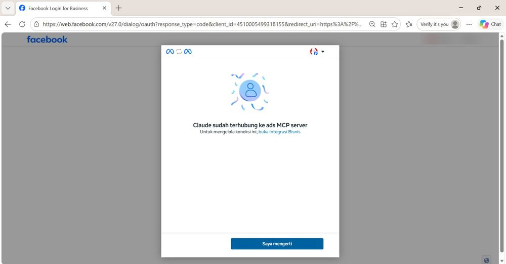

### 3.13 · Kembali ke aplikasi
Peramban menampilkan "Finish in the desktop app". Klik **Open desktop app**.

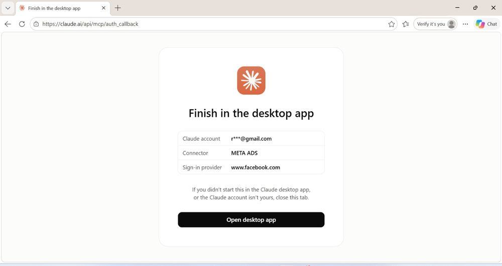

### 3.14 · Terhubung
Di aplikasi Claude, **META ADS** kini berstatus **Terhubung**.

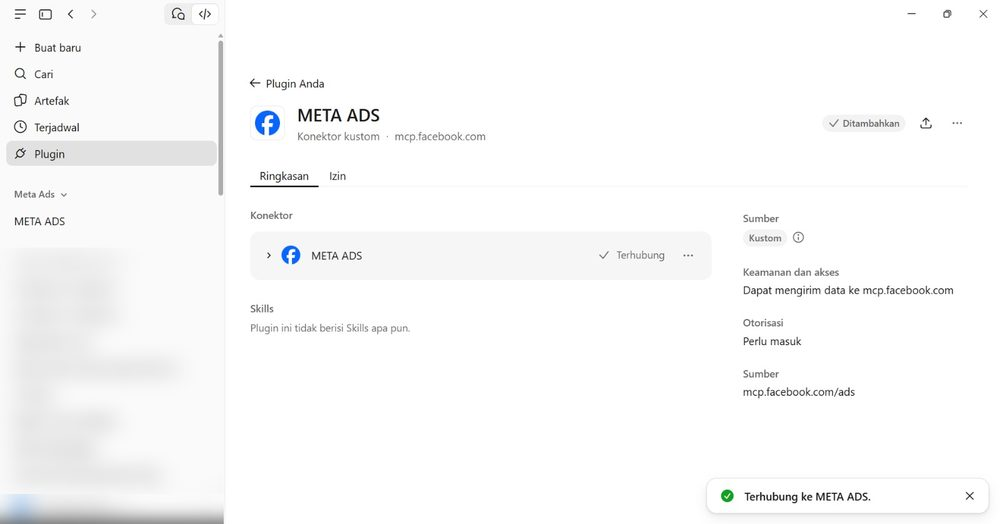

**Selesai kalau:** konektor **META ADS** berstatus **Terhubung**.

---

## Langkah 4 · Pasang file sistem dan mulai

**Sebelum dibuka:** ekstrak paket Anda. Taruh berkas **`CLAUDE.md`** dan folder **`materi`** di satu folder, misalnya `Iklan-Saya`. Taruh gambar atau video iklan di folder `materi` (siapkan ukuran **9:16** dan **1:1**).

### 4.1 · Buat sesi baru
Di tab **Code**, klik **Buat baru**.

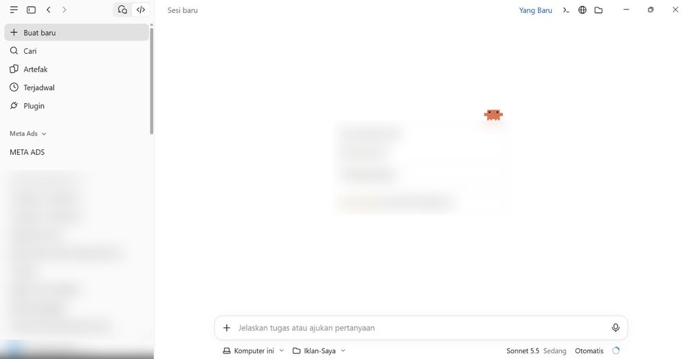

### 4.2 · Pilih folder
Klik nama folder di bagian bawah, lalu pilih folder **Iklan-Saya** (hasil ekstrak) dan klik **Select Folder**.

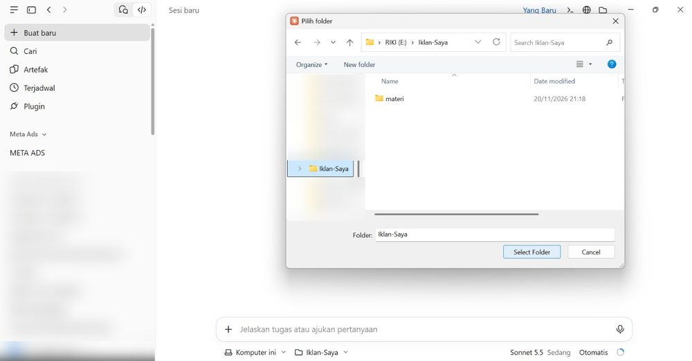

### 4.3 · Ketik "mulai"
Ketik **`mulai`**, lalu tekan Enter.

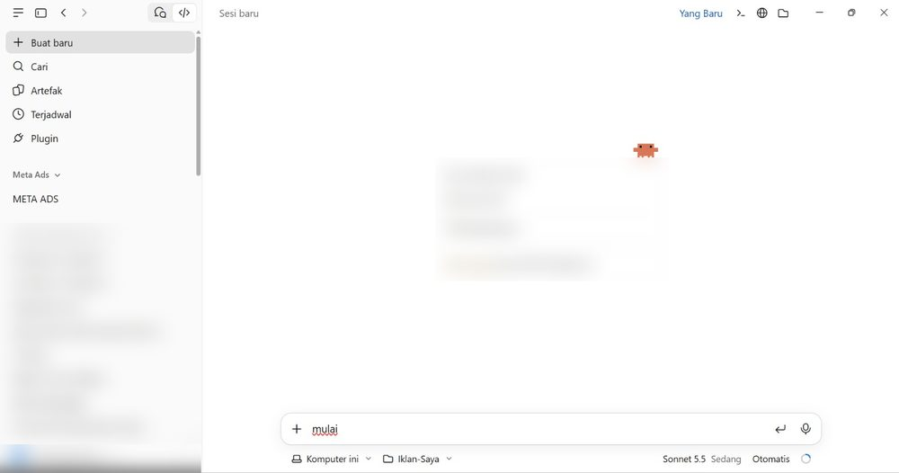

### 4.4 · Pilih akun iklan, siap digunakan
Claude membaca `CLAUDE.md` sendiri, memeriksa akun Anda, lalu menampilkan daftar akun iklan. **Pilih akun iklan** yang akan dipakai.

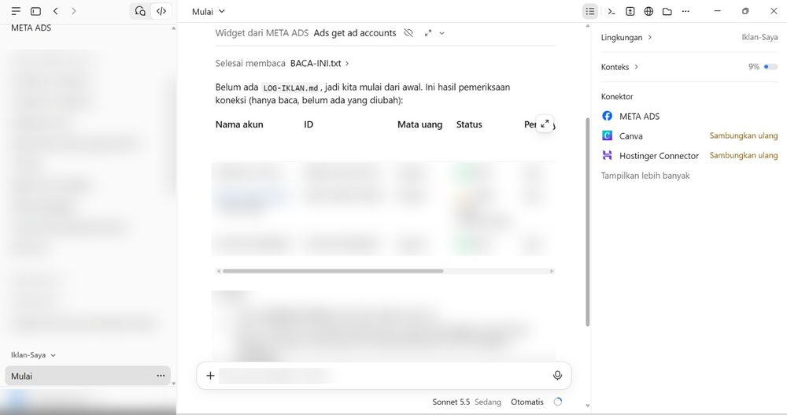

Selanjutnya Claude bertanya **satu hal sekali**: apa yang dijual, tujuan, anggaran, lokasi, dan tanggal. Anda cukup menjawab. Aturannya:

- Claude menulis **rencana**. Tulis "rencana disetujui" bila cocok.
- Semua dibuat dalam keadaan **jeda**. Anda memeriksa **Pratinjau** di Ads Manager.
- Iklan **baru menyala** setelah Anda menulis "saya setuju menyalakan".

**Selesai kalau:** Claude menampilkan akun iklan Anda dan mulai bertanya tentang iklan Anda.

---

## Prompt pengaturan iklan (salin, isi, tempel)

Agar tidak ditanya satu per satu, **tempel prompt ini** di sesi Claude Code, setelah mengisi bagian `[ ... ]`. Claude hanya akan menanyakan yang masih kurang, lalu menulis rencana.

```
Saya ingin memasang iklan Meta. Ikuti CLAUDE.md.

DIJUAL       : [nama produk/jasa, untuk siapa, harga, tanggal atau kuota]
TUJUAN       : [orang membuka halaman / mendaftar / membeli]
LINK TUJUAN  : https://[alamat halaman Anda]
ANGGARAN     : total Rp [angka] selama [jumlah] hari, dari [tanggal mulai] sampai [tanggal selesai]
LOKASI       : [kota + radius km, atau seluruh Indonesia]
USIA PEMBELI : [mis. 28-48] (cukup jadi saran / orang di luar usia ini tidak boleh melihat iklan)
MATERI       : file di folder materi: [nama file]
JANGAN DIKATAKAN : [hal yang tidak boleh ditulis di iklan]
IZIN         : [ada wajah anak atau testimoni? sudah ada izin tertulis? musik berlisensi?]

Buat rencana dulu. Jangan membuat apa pun sebelum saya tulis "rencana disetujui".
```

**Contoh terisi:**

```
Saya ingin memasang iklan Meta. Ikuti CLAUDE.md.

DIJUAL       : Kursus Excel online untuk karyawan pemula, 4 pertemuan, Rp299.000, mulai 5 Desember
TUJUAN       : orang mendaftar lewat halaman pendaftaran
LINK TUJUAN  : https://contoh.com/kursus-excel
ANGGARAN     : total Rp300.000 selama 6 hari, dari 25 November sampai 30 November
LOKASI       : seluruh Indonesia
USIA PEMBELI : 22-40 (cukup jadi saran)
MATERI       : promo-1x1.png dan promo-9x16.png
JANGAN DIKATAKAN : jangan menjanjikan kenaikan gaji
IZIN         : tidak ada wajah anak atau testimoni
```

Setelah Claude menulis rencana, baca. Bila cocok, tulis **`rencana disetujui`**. Semua dibuat **jeda**, dan iklan baru menyala setelah Anda menulis **`saya setuju menyalakan`**.

### Prompt untuk sesudah iklan jalan

| Anda ingin | Tempel ini |
|---|---|
| Melihat hasil | `Tampilkan hasil iklan saya sejak mulai tayang dan tunjukkan di mana masalahnya.` |
| Menghentikan sementara | `Jeda semua iklan saya sekarang.` |
| Menyalakan lagi | `Nyalakan lagi iklan saya.` (Claude akan meminta Anda menulis "saya setuju menyalakan") |
| Memperpanjang | `Perpanjang iklan sampai [tanggal]. Tunjukkan dulu total biaya barunya.` |
| Mengganti teks | `Ganti teks utama iklan menjadi: [teks baru]. Tunjukkan dulu sebelum diterapkan.` |
| Menambah iklan | `Tambah satu iklan dari file [nama file] dengan teks: [teks].` |

---

## Bila macet

| Masalah | Yang dilakukan |
|---|---|
| Muncul pesan **"Tidak dapat mendaftar ke layanan masuk"** saat menekan Hubungkan | Alamat server salah, biasanya kurang `/ads`. Hapus konektornya, lalu tambahkan lagi dengan alamat persis `https://mcp.facebook.com/ads` |
| Akun iklan saya **tidak muncul** di daftar Claude | Konektor masuk dengan akun Facebook lain. Hubungkan ulang (Langkah 3) dengan akun yang benar |
| Akun iklan muncul tetapi **belum bisa dipakai** ("Ads MCP is gradually being rolled out") | Meta membuka fitur ini **bertahap per akun iklan**. Bukan kesalahan Anda dan tidak bisa dipercepat. Pakai akun iklan lain yang sudah aktif, atau coba lagi nanti |
| Claude bilang akun "kosong" (tanpa Halaman/Instagram) | Ulangi Langkah 1: semuanya satu Portofolio Bisnis |
| Konektor sudah ditambah tetapi Claude tidak melihatnya | Mulai **sesi baru** (sesi lama belum memuat konektor baru) |
| Gagal membuat audiens dari situs | Terima **Persyaratan Audiens Khusus** di Ads Manager (menu Audiens) |
| Ada spanduk **verifikasi pengiklan** | Selesaikan sendiri di Ads Manager; hanya pemilik akun yang bisa |
| Claude minta kata sandi atau token | **Jangan berikan.** Tidak pernah diperlukan |

---

## Daftar periksa

- [ ] Halaman, Instagram, dan akun iklan satu Portofolio Bisnis
- [ ] Tab **Code** di aplikasi Claude terbuka
- [ ] Konektor **META ADS** berstatus **Terhubung** (akun Facebook yang benar)
- [ ] Folder berisi `CLAUDE.md` dan `materi`
- [ ] Izin wajah anak dan lisensi musik beres
- [ ] Iklan diperiksa lewat **Pratinjau** sebelum dinyalakan
